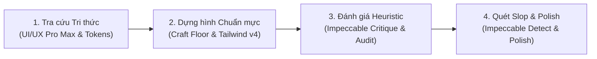

# Quy Chuẩn Thiết Kế & Hướng Dẫn Phát Triển Giao Diện (AGENTS.md)

Tài liệu này định nghĩa hệ thống tiêu chuẩn thiết kế cao cấp (Design System & Game Feel) dành cho AI Agent trong dự án **Kiếp Nhân Sinh (Vietnamese Life Simulator)**, kết hợp sức mạnh chuyên sâu từ hệ sinh thái kỹ năng: **UI/UX Pro Max**, **Impeccable**, **Design System**, **Brand** và **UI Styling**.

---

## 1. Bản Đồ Phân Vai Kỹ Năng Thiết Kế (Skill Synergy Matrix)

Các bộ kỹ năng được tổ chức theo mô hình phối hợp khép kín:

| Kỹ năng | Vị trí thư mục | Vai trò trong dự án |
| :--- | :--- | :--- |
| 🧠 **UI/UX Pro Max** | `.agents/skills/ui-ux-pro-max` | **Khối Tri thức & Gợi ý (Intelligence Engine):** Cung cấp 80 phong cách UI, 192 bảng màu, 74 cặp font chữ, và 120 nguyên tắc UX chuẩn mực cho game mô phỏng. |
| 🎨 **Design System** | `.agents/skills/design-system` | **Hệ Thống Quy Chuẩn (Foundation):** Thiết lập Design Tokens (màu sắc, typography, spacing, radius, elevation). |
| 🏷️ **Brand & Styling** | `.agents/skills/brand` & `ui-styling` | **Bản Sắc Văn Hóa & Thẩm Mỹ:** Định hình giọng điệu tự sự, màu sắc hoài niệm Việt Nam, loại trừ phong cách "AI Slop" rập khuôn. |
| 🛡️ **Impeccable** | `.agent/skills/impeccable` | **Giám Đốc Thiết Kế & Kiểm Duyệt (Quality Gatekeeper):** Quản lý `PRODUCT.md`, đánh giá UX (`critique`), rà soát kỹ thuật (`audit`), và chạy 62 bộ lọc quét lỗi cơ học (`detect`). |

---

## 2. Hệ Thống Design Tokens Chính Thức (Vietnamese Heritage System)

Mọi component và màn hình phải tuân thủ nghiêm ngặt bộ tokens định sẵn:

### A. Bảng Màu Bản Sắc Văn Hóa (Color Palette)

```text
Chủ đạo (Heritage Amber):   amber-500 (#f59e0b) | amber-400 (#fbbf24) | amber-300 (#fcd34d)
Nền sâu thẳm (Deep Slate):  slate-950 (#020617) | slate-900 (#0f172a) | slate-800 (#1e293b)
Viền & Ngăn cách (Divider): slate-800/80        | amber-500/30 (khi nổi bật)
```

**Màu nhận diện chức năng từng phân hệ:**
- 🌸 **Tình cảm & Hôn nhân:** `rose-400` / `pink-500` (ấm áp, lãng mạn).
- 🎓 **Học vấn & Trí tuệ:** `sky-400` / `blue-500` (khoa bảng, mở mang tri thức).
- 💼 **Sự nghiệp & Vị thế:** `amber-400` / `amber-500` (thành tựu, quyền uy).
- 💰 **Tài chính & Tiền bạc:** `emerald-400` / `emerald-500` (tài lộc, thịnh vượng).
- 🌿 **Tâm linh, Nhân quả & Gia đình:** `purple-400` / `indigo-400` (bình an, sâu lắng).
- ⚠️ **Rủi ro & Mặt tối:** `red-500` / `rose-500` (cảnh báo nguy hiểm).

### B. Nghệ Thuật Kiểu Chữ (Typography Pairing)

Game mô phỏng tự sự đòi hỏi chất văn học kết hợp độ rõ nét của thông số:
* **Display / Tiêu đề chính:** *Playfair Display* hoặc *Merriweather* — phông có chân hoài niệm, trang nhã, giàu cảm xúc tự sự.
* **Body / Giao diện & Số liệu:** *Be Vietnam Pro* hoặc *Inter* — phông không chân hiện đại, tối ưu hiển thị dấu tiếng Việt hoàn hảo, số liệu tài chính rõ ràng.

### C. Bề Mặt & Chiều Sâu (Surface & Glassmorphism)
- Sử dụng hiệu ứng **Glassmorphism mờ nhẹ**: `bg-slate-900/80 backdrop-blur-md border border-slate-800/80`.
- Card nổi bật sử dụng viền phát sáng gradient: `bg-gradient-to-br from-amber-500/10 via-slate-900 to-slate-900 border border-amber-500/30`.
- Góc bo tròn tiêu chuẩn: Thẻ card lớn `rounded-2xl`, nút bấm và chip `rounded-xl`.

---

## 3. Quy Chuẩn Cảm Xúc Game (Game Feel & Micro-interactions)

Giao diện không được khô cứng như phần mềm văn phòng, mà phải tạo cảm xúc gắn bó với kiếp người:

1. **Nút "Năm Tiếp Theo" Quyền Lực (Hero Next-Year Button):**
   - Luôn là phần tử kêu gọi hành động (CTA) nổi bật nhất màn hình.
   - Có gradient ấm áp (`from-amber-500 to-amber-600`), hiệu ứng đổ bóng mềm (`shadow-amber-500/25`), nảy nhẹ khi rê chuột (`hover:scale-[1.02] active:scale-[0.98]`).
2. **Hiệu ứng Biến Động Chỉ Số (Stat Pulse Feedback):**
   - Khi tăng chỉ số: nhấp nháy ánh xanh lục nhẹ (`emerald`).
   - Khi giảm sức khỏe/hạnh phúc: cảnh báo ánh đỏ nhẹ (`rose`).
   - Tiền thưởng lớn / Trúng số độc đắc: Kích hoạt hiệu ứng pháo hoa `confetti` tạo khoảnh khắc hưng phấn (dopamine hit).
3. **Avatar Sống Động Theo Tâm Trạng:**
   - Biểu cảm khuôn mặt phản ứng với chỉ số Hạnh phúc (vui / mỉm cười / u sầu).
   - Ngoại hình già hóa tự nhiên theo 6 giai đoạn cuộc đời (Sơ sinh ➔ Nhi đồng ➔ Thiếu niên ➔ Trưởng thành ➔ Trung niên ➔ Lão niên).
4. **Phản Hồi Tức Thì (Instant Toast System):**
   - Mọi hành động (xin tăng lương, mua xe, tỏ tình, cào vé số) phải hiển thị hộp thông báo kết quả sinh động, tự động biến mất sau 3.5 - 4 giây.

---

## 4. Kiến Trúc Điều Hướng Mobile-First

1. **Thanh Điều Hướng Đáy (Bottom Navigation Bar):**
   - Tối ưu cho thao tác bằng ngón tay cái trên thiết bị di động.
   - Chiều cao vùng chạm tối thiểu **44×44px** (khuyến nghị **48×48px**).
   - Nhãn chữ ngắn gọn, không gãy dòng, icon rõ ràng từ `lucide-react`.
2. **Bố Cục Nội Dung Đáp Ứng (Responsive Grid):**
   - Mobile (< 640px): 1 cột thẻ, khoảng cách `gap-3`.
   - Tablet / Desktop (>= 640px): 2 cột thẻ cân đối, chiều rộng tối đa `max-w-4xl mx-auto`.

---

## 5. Quy Trình Phối Hợp 4 Bước Nâng Tầm Giao Diện



### Bước 1: Tra cứu & Lựa chọn hệ thống thiết kế
Trước khi code component mới, tra cứu các mẫu bố cục hoặc quy tắc UX chuẩn:
```powershell
python .agents/skills/ui-ux-pro-max/scripts/search.py "life simulator story narrative game" --design-system
python .agents/skills/ui-ux-pro-max/scripts/search.py "mobile touch target" --domain ux
```

### Bước 2: Dựng hình với Sàn Chất Lượng (Craft Floor)
- **Tuyệt đối không dùng emoji làm icon** trong UI chính (luôn dùng SVG vector từ `lucide-react`).
- **Không lạm dụng gradient tím - xanh** rập khuôn của AI; trung thành với bảng màu ấm cúng `amber`, `slate-900`, `emerald`.
- Mọi nút bấm tương tác phải có `cursor-pointer`, chuyển trạng thái `hover` và `active` mượt mà.
- Độ tương phản chữ và nền luôn đạt tối thiểu **4.5:1** (WCAG AA).

### Bước 3: Đánh giá Heuristic & Khả năng tiếp cận
- Kích hoạt `/impeccable critique [component]` để đánh giá độ thấu cảm và nhịp điệu tương tác.
- Kích hoạt `/impeccable audit [component]` để rà soát hiển thị đa màn hình (iPhone 390px, iPad 768px, Desktop 1440px).

### Bước 4: Quét Cơ Học & Tinh Chỉnh Cuối (Polish)
1. **Chạy bộ quét chống lỗi thiết kế:**
   ```powershell
   cmd /c ".agent\skills\impeccable\scripts\impeccable.cmd detect src/"
   ```
2. **Kiểm tra hoàn thiện:**
   - Định dạng tiền tệ VNĐ chuẩn xác: *12.5 triệu đ*, *2.5 tỷ đ*.
   - Đảm bảo câu từ tiếng Việt không bị lỗi mồ côi từ (widowed text) hoặc tràn khung modal.

---

## 6. Bảng Checklist Nghiệm Thu UI/UX Trước Khi Bàn Giao

Mỗi khi hoàn thành hoặc cải tiến một màn hình, đối chiếu với checklist sau:

- [ ] **Màu sắc:** Tuân thủ bảng màu Heritage Amber & Slate-900, không có gradient tím-xanh rập khuôn.
- [ ] **Icon:** 100% icon SVG đồng bộ từ `lucide-react`, kích thước đồng đều 16×16px hoặc 20×20px.
- [ ] **Tương tác:** Mọi nút có `cursor-pointer`, hiệu ứng nảy/chuyển màu khi rê chuột hoặc bấm.
- [ ] **Typography:** Tiếng Việt có dấu đầy đủ, chuẩn chính tả, không ngắt dòng gãy từ.
- [ ] **Mobile:** Không bị thanh cuộn ngang ngoài ý muốn, touch target đạt tối thiểu 44×44px.
- [ ] **Feedback:** Có phản hồi trực quan (toast, pulse, confetti) khi người chơi thực hiện lựa chọn.
- [ ] **Build:** Biên dịch sạch sẽ `npm run build` không cảnh báo hay lỗi kiểu dữ liệu.
