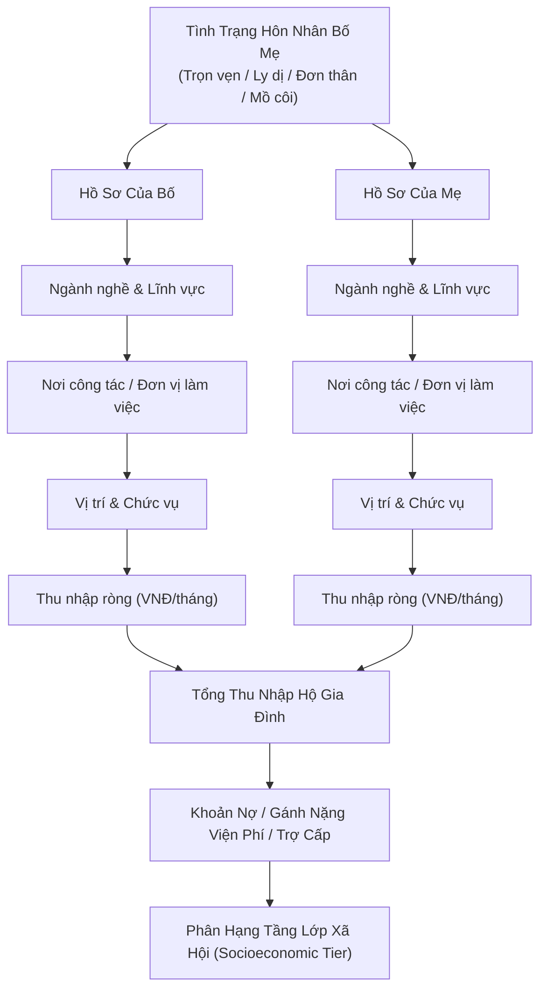

# Bản Kế Hoạch Hệ Thống Gia Cảnh & Thu Nhập Bố Mẹ (Game Làm Cha Mẹ)

> **Mục tiêu**: Xây dựng thuật toán tạo lập hồ sơ gia đình ngẫu nhiên (*Procedural Family Generator*) chân thực 100% với xã hội Việt Nam hiện đại, từ nghề nghiệp, cơ quan công tác, chức vụ đến dòng tiền thu nhập hàng tháng, phản ánh chính xác vị thế xã hội và điều kiện xuất phát điểm của nhân vật ở tuổi 18.

---

## 1. Kiến Trúc Dữ Liệu Gia Cảnh (Data Architecture)



---

## 2. Danh Mục 6 Khối Nơi Công Tác & Ma Trận Thu Nhập (Workplace & Salary Matrix)

### Khối 1: Hành Chính Sự Nghiệp & Nhà Nước (Public Sector)
| Nghề nghiệp | Đơn vị / Nơi công tác | Chức vụ | Thu nhập thực tế (triệu VNĐ/tháng) | Đặc điểm bối cảnh |
| :--- | :--- | :--- | :---: | :--- |
| **Công chức hành chính** | UBND Xã / Phường | Cán bộ địa chính / Tư pháp | 7 – 11 | Lương ổn định, am hiểu thủ tục đất đai |
| **Công chức hành chính** | UBND Quận / Sở ban ngành | Trưởng phòng / Phó phòng | 15 – 28 | Quan hệ rộng, nếp nhà chỉn chu |
| **Lãnh đạo cơ quan** | UBND Tỉnh / Sở Tài chính | Giám đốc Sở / Lãnh đạo | 35 – 70+ | Gia đình quyền thế, kỳ vọng con cái cao |
| **Giáo viên mầm non/tiểu học** | Trường tiểu học công lập | Giáo viên đứng lớp | 6.5 – 10 | Đi làm sớm về muộn, giàu tình cảm |
| **Giáo viên THPT** | Trường THPT Chuyên tỉnh | Tổ trưởng chuyên môn (+ dạy thêm) | 20 – 40 | Rất chú trọng thành tích học tập của con |
| **Giảng viên Đại học** | Đại học Quốc gia / Kinh tế | Phó giáo sư / Trưởng khoa | 35 – 65 | Tri thức uyên bác, định hướng con du học |
| **Bác sĩ bệnh viện công** | Bệnh viện đa khoa huyện | Bác sĩ điều trị | 12 – 18 | Trực đêm vất vả, ít thời gian ở nhà |
| **Bác sĩ chuyên khoa** | Bệnh viện Trung ương (Bạch Mai, Chợ Rẫy) | Phó khoa (+ Phòng khám tư) | 50 – 120 | Tài chính vững, muốn con nối nghiệp Y |
| **Công an nhân dân** | Công an Phường / Huyện | Cán bộ điều tra / CSGT | 14 – 25 | Kỷ luật thép, con cái phải nề nếp |
| **Quân đội nhân dân** | Sư đoàn / Bộ chỉ huy quân sự | Sĩ quan cấp Tá | 18 – 30 | Thường xuyên công tác xa nhà |

---

### Khối 2: Doanh Nghiệp Tư Nhân & Tập Đoàn (Private Corporate)
| Nghề nghiệp | Đơn vị / Nơi công tác | Chức vụ | Thu nhập thực tế (triệu VNĐ/tháng) | Đặc điểm bối cảnh |
| :--- | :--- | :--- | :---: | :--- |
| **Lập trình / Công nghệ** | Công ty gia công phần mềm | Senior Developer | 35 – 55 | Thức khuya, tư duy logic, hỗ trợ con công nghệ |
| **Lãnh đạo công nghệ** | Tập đoàn công nghệ (FPT, Viettel) | Giám đốc công nghệ (CTO) | 80 – 160 | Nhà có điều kiện, hiện đại |
| **Nhân viên văn phòng** | Công ty thương mại SME | Kế toán viên / Hành chính | 9 – 14 | Lương trung bình, chi tiêu chặt chẽ |
| **Kế toán trưởng** | Doanh nghiệp xuất nhập khẩu | Kế toán trưởng | 30 – 50 | Quản lý tiền bạc gia đình tỉ mỉ |
| **Nhân viên ngân hàng** | Ngân hàng TMCP (Vietcombank, MB) | Giao dịch viên | 12 – 18 | Chỉn chu hình thức, áp lực chỉ tiêu KPI |
| **Giám đốc chi nhánh** | Ngân hàng thương mại | Giám đốc chi nhánh | 60 – 120 | Gia cảnh giàu có, xe hơi nhà lầu |
| **Quản lý nhà máy FDI** | Tập đoàn FDI (Samsung, LG, Foxconn) | Trưởng phòng sản xuất | 40 – 75 | Tác phong công nghiệp, kỷ luật cao |

---

### Khối 3: Hộ Kinh Doanh & Tiểu Thương (Trade & Small Business)
| Nghề nghiệp | Đơn vị / Nơi công tác | Chức vụ | Thu nhập thực tế (triệu VNĐ/tháng) | Đặc điểm bối cảnh |
| :--- | :--- | :--- | :---: | :--- |
| **Tiểu thương chợ dân sinh** | Chợ huyện / Chợ truyền thống | Chủ sạp rau củ / thịt cá | 12 – 22 | Thức dậy từ 3h sáng, thương con vất vả |
| **Tiểu thương sạp lớn** | Chợ đầu mối (Đồng Xuân, Bến Thành, Ninh Hiệp) | Chủ sạp vải / đồ gia dụng | 45 – 90 | Tiền mặt dồi dào, tháo vát mua bán |
| **Chủ tiệm tạp hóa** | Mặt tiền phố huyện | Chủ tiệm tạp hóa | 15 – 28 | Cả nhà quây quần quanh tiệm buôn bán |
| **Chủ quán ăn / Cà phê** | Quán phở / Quán cơm bình dân | Chủ quán kiêm bếp chính | 25 – 50 | Thu nhập tốt nhưng vất vả dầu mỡ, phụ việc |
| **Chủ xưởng cơ khí / Gỗ** | Làng nghề mộc / Cơ khí | Chủ xưởng (thuê 10 thợ) | 60 – 150 | Cơ ngơi bề thế, muốn con về nối nghiệp xưởng |
| **Đại lý phân phối lớn** | Tổng đại lý vật liệu xây dựng | Chủ doanh nghiệp gia đình | 100 – 300+ | Đại gia phố thị, nhiều bất động sản |

---

### Khối 4: Nông Nghiệp, Thủy Hải Sản & Nông Thôn (Rural & Agriculture)
| Nghề nghiệp | Đơn vị / Nơi công tác | Chức vụ | Thu nhập thực tế (triệu VNĐ/tháng) | Đặc điểm bối cảnh |
| :--- | :--- | :--- | :---: | :--- |
| **Nông dân làm ruộng** | Hợp tác xã nông thôn | Trồng lúa (3 – 5 sào ruộng) | 5 – 9 | Phụ thuộc thời tiết, mùa vụ; chắt chiu từng bao thóc |
| **Chủ vườn cây ăn trái** | Miệt vườn miền Tây / Đông Nam Bộ | Chủ vườn sầu riêng, thanh long | 30 – 100 | Lúc trúng mùa tiền tỷ, lúc rớt giá lo âu |
| **Trồng cây công nghiệp** | Nông trường Tây Nguyên | Chủ vườn cà phê, hồ tiêu | 25 – 60 | Lao động chân tay khỏe mạnh, nhà gỗ khang trang |
| **Nuôi trồng thủy sản** | Bè cá tra, đầm tôm miền Tây | Chủ đầm tôm | 40 – 120 | Đầu tư lớn, được mất theo giá tôm thị trường |
| **Ngư dân đánh bắt** | Tàu đánh cá biển xa | Bạn thuyền / Lao động biển | 8 – 15 | Sóng gió lênh đênh, xa nhà hàng tháng trời |
| **Thuyền trưởng tàu cá** | Tàu cá công suất lớn | Chủ tàu đánh bắt | 35 – 80 | Gan góc, hào sảng, phong trần |

---

### Khối 5: Lao Động Phổ Thông & Dịch Vụ Cơ Bản (Gig Economy & Workers)
| Nghề nghiệp | Đơn vị / Nơi công tác | Chức vụ | Thu nhập thực tế (triệu VNĐ/tháng) | Đặc điểm bối cảnh |
| :--- | :--- | :--- | :---: | :--- |
| **Công nhân nhà máy** | Khu công nghiệp (Bình Dương, Bắc Ninh) | Công nhân may / Lắp ráp linh kiện | 7.5 – 11.5 | Tăng ca triền miên (OT), gửi tiền về nuôi con |
| **Tài xế công nghệ / Taxi** | Grab / Be / Mai Linh | Tài xế tự do | 11 – 17 | Chạy xe cả ngày dưới nắng mưa, rủi ro giao thông |
| **Tài xế xe tải đường dài** | Đội xe container Hải Phòng / Sài Gòn | Tài xế đường dài | 18 – 26 | Xa nhà nhiều ngày, ăn ngủ trên vô lăng |
| **Thợ xây / Thợ nề** | Đội thợ xây dựng công trình | Thợ chính | 12 – 18 | Dầm mưa dãi nắng, công việc theo mùa công trình |
| **Buôn bán hàng rong** | Vỉa hè đô thị | Bán vé số / Bánh mì / Thu mua phế liệu | 4.5 – 8 | Bấp bênh, gia cảnh cực kỳ khó khăn |
| **Giúp việc gia đình** | Dịch vụ giúp việc theo giờ / Ở lại nhà | Lao động gia đình | 7 – 10 | Chịu thương chịu khó, dành dụm từng đồng |

---

### Khối 6: Cán Bộ Hưu Trí & Trợ Cấp Xã Hội (Retirees)
| Tình trạng | Chi tiết nguồn gốc | Nguồn thu nhập | Thu nhập thực tế (triệu VNĐ/tháng) | Đặc điểm bối cảnh |
| :--- | :--- | :--- | :---: | :--- |
| **Cán bộ về hưu** | Nguyên cán bộ cơ quan / Giáo viên | Lương hưu bảo hiểm xã hội | 6 – 12 | Cuộc sống thanh đạm, đọc sách báo, chăm cây cảnh |
| **Sĩ quan quân đội hưu trí** | Nguyên sĩ quan cao cấp | Lương hưu quân đội | 14 – 22 | Tác phong chuẩn mực, uy tín cao trong làng xóm |
| **Mất sức lao động** | Tai nạn lao động / Bệnh mạn tính | Trợ cấp xã hội ít ỏi | 2 – 4 | Gánh nặng thuốc men hàng tháng, con phải đỡ đần |

---

## 3. Bảng Phân Hạng Tầng Lớp Gia Cảnh (Socioeconomic Tiers)

Dựa trên **Tổng thu nhập tháng của Bố + Mẹ** trừ đi chi phí nợ/bệnh tật:

| Phân Hạng Tầng Lớp | Tổng Thu Nhập Hộ (VNĐ/tháng) | Tình Cảnh Gia Đình Ở Tuổi 18 | Điều Kiện Bước Vào Đời |
| :--- | :---: | :--- | :--- |
| 🔴 **Hộ Nghèo / Nợ Nần** | Dưới 10 triệu *(hoặc âm do nợ)* | Bố mẹ còng lưng trả nợ ngân hàng hoặc tiền thuốc; bữa cơm đạm bạc rau muống cá kho. | Rất khó học tiếp đại học; 80% phải đi làm thuê ngay hoặc học nghề ngắn hạn để phụ gia đình. |
| 🟠 **Bình Dân / Đủ Ăn** | 12 – 28 triệu | Đủ chi trả ăn uống, tiền điện nước; có một chiếc xe máy đi lại; tiền tiết kiệm ít. | Nếu đỗ đại học, gia đình nuôi được mức tối thiểu, nhân vật phải đi làm thêm kiếm tiền sinh hoạt. |
| 🟢 **Khá Giả / Trung Lưu** | 35 – 70 triệu | Có nhà đất kiên cố hoặc chung cư; xe ô tô hạng phổ thông; không phải lo tiền ăn học. | Tự do chọn trường đại học theo đam mê; được bố mẹ chu cấp đầy đủ laptop xịn, xe máy mới. |
| 💎 **Thượng Lưu / Giàu Có** | 80 – 180 triệu | Biệt thự, xe sang, sở hữu nhiều sổ đỏ; có vị thế xã hội cao. | Được định hướng du học các nước phát triển, hoặc học trường quốc tế; sẵn sàng vốn khởi nghiệp. |
| 👑 **Đại Gia / Tinh Hoa** | Trên 250 triệu đến hàng tỷ | Doanh nghiệp nghìn tỷ, chuỗi khách sạn, xuất nhập khẩu; dòng họ bề thế. | Không bao giờ phải lo về tiền; áp lực là gánh vác cơ nghiệp gia đình và môn đăng hộ đối. |

---

## 4. Các Biến Thể Cấu Trúc Gia Đình (Family Dynamic Variants)

Khi người chơi tạo nhân vật, hệ thống sẽ ngẫu nhiên chọn 1 trong 4 kịch bản tổ ấm:

1. **Gia Đình Trọn Vẹn (70%)**: Đủ Bố và Mẹ sống cùng nhau, đồng thuận nuôi dạy con cái.
2. **Bố Mẹ Ly Hôn / Đơn Thân (15%)**:
   * *Ở với Mẹ*: Mẹ gánh vác việc nhà và kiếm tiền, Bố gửi trợ cấp 2 – 5 triệu/tháng (hoặc bố bặt vô âm tín).
   * *Ở với Bố*: Bố đi bước nữa, sống cùng Mẹ kế (có kịch bản quan hệ mẹ kế - con chồng hòa thuận hoặc lạnh nhạt).
3. **Mồ Côi Sớm (10%)**:
   * Mất Bố hoặc Mất Mẹ từ nhỏ do bệnh tật/tai nạn; người còn lại ở vậy nuôi con.
   * Hoặc mồ côi cả hai, lớn lên trong vòng tay yêu thương của Ông Bà già yếu ở quê.
4. **Biến Cố Phá Sản / Tai Ương (5%)**:
   * Từng là gia đình khá giả, nhưng Bố/Mẹ vướng vào vỡ nợ bất động sản, lừa đảo đa cấp hoặc bài bạc nợ tiền tỷ ➔ Nhân vật ở tuổi 18 trải qua cú sốc tâm lý sa sút từ giàu sang xuống bần hàn.

---

## 5. Quy Trình Hiển Thị Trên Thẻ "Hồ Sơ Xuất Phát"

Khi người chơi bấm **"Xuất phát điểm khác"**, thẻ giao diện sẽ tự động tổng hợp câu chuyện:

```text
[Chân Dung 18T]  Nguyễn Hoàng Nam
                 Nam · 18 tuổi · Nam Định · Việt Nam

NƠI SINH:        Nam Định
GIA ĐÌNH:        Bố giáo viên THPT chuyên · Mẹ bác sĩ khoa Nhi tỉnh
THU NHẬP NHÀ:    58.000.000 đ/tháng (Bố 24 tr · Mẹ 34 tr)
BỐI CẢNH:        Nếp nhà gia giáo, trọng tri thức; bố mẹ kỳ vọng con nối nghiệp
                 đèn sách; tài chính ổn định, sẵn sàng chu cấp học đại học.
HỌC LỰC CẤP 3:   Giỏi (Điểm thi tốt nghiệp: 26.5 điểm - Khối A)
NĂNG KHIẾU:      Logic toán học & Thể thao
TAGS:            [Khá giả] [Thị trấn] [Gia đình học thức]

                 [ ↻ Xuất phát điểm khác ]   [ Sống đời này › ]
```
