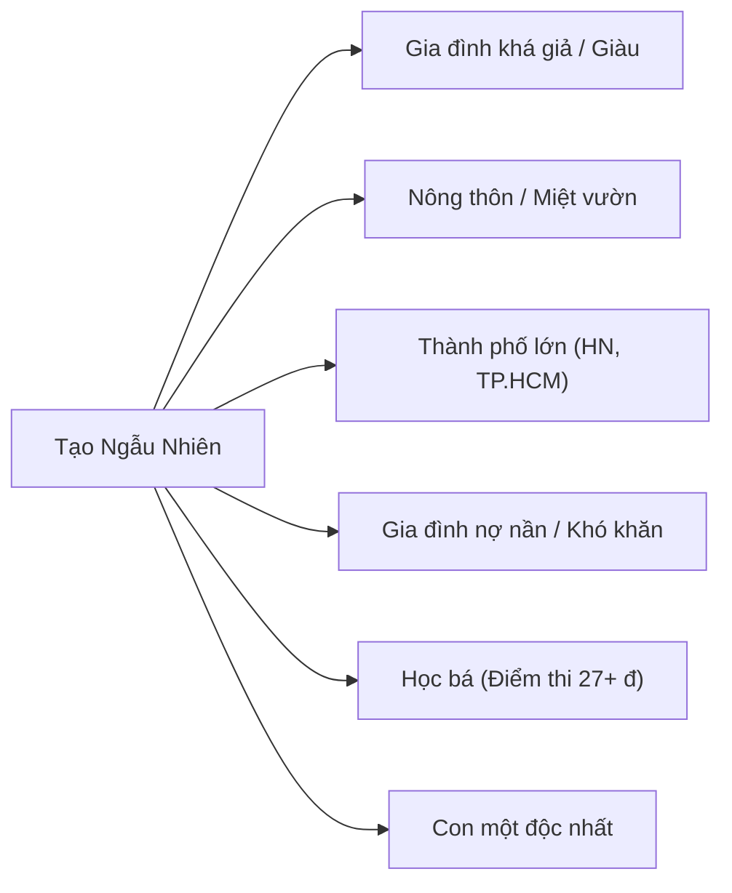
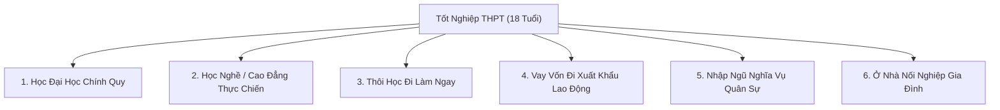

# Bản Kế Hoạch: Hồ Sơ Xuất Phát & 6 Ngã Rẽ Tuổi 18 (Game Làm Cha Mẹ)

> **Mục tiêu**: Thiết kế hệ thống khởi tạo hồ sơ nhân vật năm 18 tuổi (vừa tốt nghiệp THPT) với giao diện tương đồng thẻ thông tin thực tế, kết hợp bộ lọc ngẫu nhiên và mở ra 6 ngã rẽ cuộc đời then chốt định hình toàn bộ tương lai.

---

## 1. Cấu Trúc Thẻ "Hồ Sơ Xuất Phát" (Starting Profile Card)

Màn hình xuất phát mô phỏng một tờ lý lịch cô đọng, sắc nét, phản ánh thực tế xã hội Việt Nam với các trường dữ liệu sau:

| Trường thông tin | Dữ liệu hiển thị mẫu | Mô tả logic & Tác động |
| :--- | :--- | :--- |
| **Ảnh đại diện & Giới tính** | Avatar Anime / Pixel 16x16 · Nam / Nữ | Người chơi có thể chọn làm **Người Ba** hoặc **Người Mẹ** tương lai, hoặc để hệ thống random |
| **Họ & Tên** | *Nguyễn Hoàng Long / Trần Mai Phương* | Họ tên thuần Việt chuẩn theo kho dữ liệu 100+ họ tên phổ biến |
| **Nơi sinh** | *Nam Định / Cần Thơ / Đà Nẵng / Hà Nội...* | 63 tỉnh thành Việt Nam, quyết định yếu tố văn hóa vùng miền (Bắc - Trung - Nam) |
| **Gia đình** | *Bố thợ hàn cơ khí · Mẹ công nhân may* | Nghề nghiệp cụ thể và nơi công tác của bố mẹ theo Ma trận 6 khối nghề |
| **Thu nhập nhà** | *22.500.000 đ/tháng (Bố 13.5 tr · Mẹ 9 tr)* | Phân định tầng lớp: Nghèo (<12tr), Bình dân (12-30tr), Khá giả (30-80tr), Giàu (>80tr) |
| **Bối cảnh gia đình** | *Nhà cấp 4 ngoại ô, bố mẹ chắt chiu nuôi 2 con; gia đình êm ấm, hay ăn cơm cùng nhau.* | Đoạn văn tóm tắt hoàn cảnh tình cảm, tài chính và quan hệ anh chị em trong nhà |
| **Học lực cấp 3** | *Học lực Khá · Điểm thi: 24.5 đ (Khối A00: Toán, Lý, Hóa)* | Điểm thi tốt nghiệp THPT quyết định điều kiện xét tuyển vào đại học hoặc các trường nghề |
| **Năng khiếu bẩm sinh** | *Khéo tay / Hùng biện / Nhanh nhạy số liệu / Thể lực bền bỉ...* | Buff chỉ số chuyên môn khi làm một số công việc hoặc giải quyết tình huống sau này |

---

## 2. Hệ Thống Thẻ Lọc Nhanh (Filter Tags & Reroll Conditions)

Người chơi có thể ấn nút **"Xuất phát điểm khác"** để random tự do, hoặc bấm chọn các thẻ lọc sẵn để trải nghiệm các bối cảnh xã hội mong muốn:

- **[Gia đình giàu có]**: Thu nhập bố mẹ > 70 triệu/tháng, nhà có xe hơi, bố mẹ sẵn sàng chu cấp toàn bộ chi phí học đại học hoặc cho vốn làm ăn.
- **[Nông thôn]**: Bố mẹ làm nông, nuôi tôm hoặc buôn bán nhỏ tại chợ huyện; có ruộng vườn; tính cách mộc mạc; áp lực thi đại học để thoát ly nông thôn.
- **[Thành thị]**: Sinh sống tại đô thị lớn, quen thuộc nếp sống nhộn nhịp, chi phí sinh hoạt đắt đỏ, gia đình có nhà riêng hoặc ở tập thể.
- **[Nhà nợ nần]**: Gia đình vướng nợ ngân hàng hoặc nợ người thân từ 50 – 300 triệu; nhân vật phải vừa học vừa làm hoặc đi làm ngay để phụ bố mẹ.
- **[Học bá xuất chúng]**: Điểm thi THPT từ 26.5 – 29 điểm; mở khóa thẳng các ngành Đại học Top 1 (Bách Khoa, Ngoại Thương, Y Hà Nội/Y Dược TP.HCM).

---

## 3. Chi Tiết 6 Ngã Rẽ Định Mệnh Sau Tốt Nghiệp THPT (Tuổi 18)

Sau khi bấm **"Sống đời này"**, người chơi đối mặt với quyết định lớn đầu đời: Lựa chọn 1 trong 6 con đường sau:

---

### Ngã Rẽ 1: Học Đại Học Chính Quy (University)
- **Thời gian**: 4 – 6 năm (Tùy khối ngành Kinh tế, Kỹ thuật hay Y khoa).
- **Điều kiện**: Điểm thi THPT phù hợp (Top 1: ≥25đ, Top 2: ≥20đ, Dân lập/Địa phương: ≥16đ).
- **Chi phí**: 15 – 45 triệu đ/năm (Học phí) + 4 – 7 triệu đ/tháng (Tiền trọ, ăn uống tại thành phố lớn).
- **Lựa chọn chỗ ở**: Ký túc xá sinh viên (tiết kiệm, 8 người/phòng, rèn kỹ năng tập thể) hoặc Thuê trọ bên ngoài (tự do, tốn kém).
- **Cơ hội**: 
  - Gặp gỡ bạn đời tiềm năng trong môi trường trí thức/sinh viên.
  - Cơ hội thăng tiến lên chuyên viên, quản lý, kỹ sư sau 24 tuổi.
- **Rủi ro**: 
  - Gánh nặng tài chính lên bố mẹ.
  - Nguy cơ thất nghiệp nếu chọn sai ngành hoặc ra trường bằng trung bình, thiếu kỹ năng thực tế.

---

### Ngã Rẽ 2: Học Nghề / Cao Đẳng Kỹ Thuật (Vocational Training)
- **Thời gian**: 1.5 – 2.5 năm.
- **Các ngành nghề tiêu biểu**: Sửa chữa ô tô, Điện lạnh - điện dân dụng, Thiết kế đồ họa/lập trình ngắn hạn, Kỹ thuật pha chế/Nấu ăn, Thẩm mỹ - làm đẹp.
- **Học phí**: Vừa phải (8 – 15 triệu đ/năm), được thực hành tại xưởng từ năm nhất.
- **Đặc điểm**: 
  - Ra trường đi làm sớm ở tuổi 20.
  - Tay nghề vững vàng, thu nhập khởi điểm thực tế (8 – 14 triệu đ/tháng).
  - Ít gánh nặng nợ nần cho bố mẹ.
- **Cơ hội kết hôn**: Dễ ổn định cuộc sống sớm, kết hôn ở độ tuổi 22 – 25.

---

### Ngã Rẽ 3: Thôi Học Đi Làm Ngay (Immediate Workforce)
- **Thời gian**: Bắt đầu ngay lập tức từ tuổi 18.
- **Vị trí công việc**: Công nhân nhà máy linh kiện (Bắc Ninh, Bình Dương), Nhân viên phục vụ nhà hàng/quán ăn, Shipper giao hàng công nghệ, Nhân viên bán hàng shop quần áo/siêu thị mini.
- **Thu nhập**: 6.5 – 12 triệu đ/tháng (phụ thuộc nhiều vào việc tăng ca OT hoặc chạy nhiều đơn).
- **Áp lực gia đình**: Phải gửi về phụ giúp bố mẹ từ 2 – 5 triệu đ/tháng để lo cho em nhỏ hoặc trả nợ nhà.
- **Đặc điểm**: 
  - Trưởng thành và va vấp đời sớm.
  - Khó thăng tiến lên mức lương cao nếu không chịu khó tự học thêm kỹ năng.
  - Môi trường tiếp xúc bạn đời là những người cùng cảnh ngộ chịu thương chịu khó.

---

### Ngã Rẽ 4: Vay Vốn Đi Xuất Khẩu Lao Động - XKLĐ (Overseas Contract Work)
- **Thị trường**: Nhật Bản (Thực tập sinh kỹ năng), Hàn Quốc (Chương trình EPS), Đài Loan (Nhà máy, hộ lý).
- **Chi phí xuất cảnh ban đầu**: 90 – 180 triệu VNĐ (thường phải vay mượn ngân hàng chính sách hoặc người thân).
- **Thời hạn hợp đồng**: 3 – 5 năm (từ 19 đến 23-24 tuổi).
- **Thu nhập**: 25 – 45 triệu đ/tháng. Sau khi trừ chi phí sinh hoạt gửi về nhà 18 – 35 triệu đ/tháng.
- **Ưu điểm**: Giúp gia đình trả sạch nợ nần, xây được nhà mới ở quê, có một khoản vốn tích lũy 400 – 700 triệu khi về nước.
- **Thách thức**: 
  - Xa xứ cô đơn, rào cản ngôn ngữ, lao động cực nhọc trong xưởng lạnh/công trường.
  - Khó duy trì mối quan hệ tình cảm ở quê nhà (nguy cơ chia tay do khoảng cách địa lý).
  - Khi về nước tuổi 24 cần định hướng lại nghề nghiệp để không bị hẫng hụt.

---

### Ngã Rẽ 5: Nhập Ngũ Nghĩa Vụ Quân Sự (Military Service)
- **Áp dụng**: Bắt buộc đối với Nam thanh niên đủ điều kiện sức khỏe loại 1, 2, 3 (hoặc tự nguyện viết đơn nhập ngũ).
- **Thời hạn**: 24 tháng (2 năm).
- **Môi trường**: Kỷ luật quân đội nghiêm ngặt, huấn luyện thể lực, rèn luyện nếp sống ngăn nắp, tính kiên cường.
- **Quyền lợi khi xuất ngũ**:
  - Nhận trợ cấp xuất ngũ (khoảng 20 – 30 triệu đ).
  - Được cấp **Thẻ học nghề miễn phí** (học lái xe hạng C, sửa chữa máy móc hoặc cơ khí).
  - Sức khỏe tăng mạnh (+30 Thể lực, +20 Tính kiên trì).
- **Tình cảm**: Thử thách mối tình thời cấp 3 ("Người yêu đi lính 2 năm ở nhà người yêu đi lấy chồng" là một biến cố kinh điển).

---

### Ngã Rẽ 6: Ở Nhà Nối Nghiệp / Phụ Giúp Kinh Doanh Gia Đình (Family Business)
- **Điều kiện**: Gia đình có cơ sở kinh doanh, xưởng mộc, tiệm tạp hóa, trang trại hoặc đầm tôm/vườn trái cây.
- **Công việc**: Học việc từ chính bố mẹ, quản lý đơn hàng, đứng bán hàng, giao hàng hoặc trực tiếp chăm sóc nông sản.
- **Thu nhập**: Ăn ở cùng bố mẹ, nhận tiền tiêu vặt hoặc lương tháng 5 – 15 triệu đ từ doanh thu gia đình.
- **Cơ hội**: Tiếp quản cơ ngơi kinh doanh vững chắc, không phải chịu cảnh làm thuê cho người ngoài, gần gũi phụng dưỡng bố mẹ.
- **Thách thức**: Thường xuyên chịu sự kiểm soát khắt khe của bố mẹ về giờ giấc và các mối quan hệ tình cảm.

---

## 4. Tác Động Của Ngã Rẽ Đến Giai Đoạn Hẹn Hò & Kết Hôn

Mỗi ngã rẽ ở tuổi 18 sẽ quyết định:
1. **Dải tuổi gặp gỡ đối tượng**: Học đại học thường kết hôn muộn hơn (26 - 30 tuổi), trong khi đi làm sớm hoặc ở quê thường kết hôn sớm (21 - 25 tuổi).
2. **Đối tượng tiếp xúc (Dating Pool)**: Sinh viên gặp sinh viên; công nhân gặp công nhân xí nghiệp; dân kinh doanh gặp đối tác buôn bán.
3. **Tiềm lực kinh tế khi làm đám cưới**: Khả năng tự chi trả tiền tiệc cưới, mua sắm nội thất hoặc mua nhà/thuê nhà.
