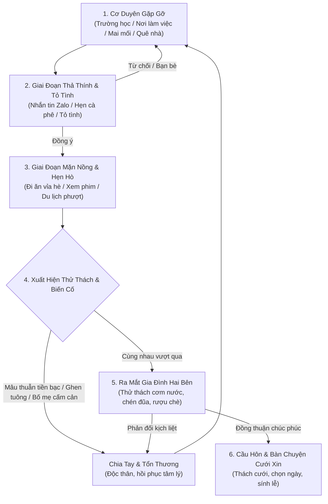
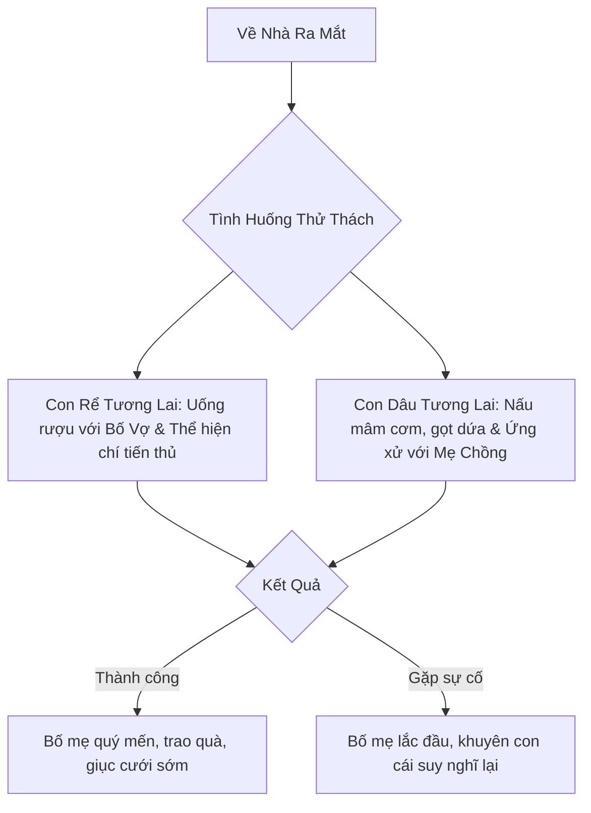

# Bản Kế Hoạch: Hệ Thống Hẹn Hò, Yêu Đương & Chọn Bạn Đời (Game Làm Cha Mẹ)

> **Mục tiêu**: Xây dựng cơ chế mô phỏng quá trình tìm hiểu, yêu đương và chọn bạn đời chân thực theo phong tục và xã hội Việt Nam. Tình yêu không chỉ là màu hồng mà gắn liền với áp lực gia cảnh, môn đăng hộ đối, sự nghiệp và thử thách của đồng tiền.

---

## 1. Vòng Đời Tình Cảm & Hôn Nhân (Dating Lifecycle)

---

## 2. Các Kênh Gặp Gỡ Đối Tượng (Meeting Channels)

Tùy vào con đường nhân vật đã chọn ở tuổi 18, danh sách đối tượng tiềm năng sẽ xuất hiện từ các hoàn cảnh khác nhau:

| Kênh gặp gỡ | Mô tả bối cảnh Việt Nam | Ưu điểm | Thách thức tiềm ẩn |
| :--- | :--- | :--- | :--- |
| **Mối tình thanh mai trúc mã ở quê** | Bạn học cùng trường cấp 3 ở quê, hoặc người cùng làng lớn lên từ nhỏ | Hiểu rõ gia cảnh, tính cách giản dị, bố mẹ hai bên quen biết | Dễ nảy sinh khoảng cách nếu một người lên thành phố, một người ở lại |
| **Bạn học Đại học / Cao đẳng** | Gặp qua nhóm bài tập, câu lạc bộ tình nguyện, ký túc xá | Tương đồng trình độ học vấn, nhiều đề tài trò chuyện | Cả hai ra trường cùng nghèo, áp lực lập nghiệp ban đầu |
| **Đồng nghiệp nơi làm việc** | Cùng công ty văn phòng, hoặc bạn cùng xưởng may, đồng nghiệp bán hàng | Thấu hiểu áp lực công việc hàng ngày, tiện gặp gỡ | Khó xử nếu chia tay trong cùng một phòng ban/công ty |
| **Người mai mối / Bố mẹ giới thiệu** | Được cô dì chú bác hoặc người lớn mai mối, sắp xếp buổi gặp mặt | Gia cảnh đã được kiểm chứng, hai bên gia đình rất ủng hộ | Thiếu rung động ban đầu, dễ bị áp lực kết hôn gấp |
| **Ứng dụng hẹn hò & Mạng xã hội** | Quen qua Facebook, Zalo, Tinder khi lướt mạng | Đối tượng đa dạng phong phú, ngoại hình ưa nhìn | Nguy cơ gặp người sống ảo, giấu giếm gia cảnh hoặc bắt cá hai tay |
| **Duyên tình cờ nơi phố thị** | Gặp tại quán trà đá vỉa hè, lớp học lái xe, sửa xe ven đường | Bất ngờ, lãng mạn như phim truyền hình | Cần nhiều thời gian kiểm chứng tính cách thực tế |

---

## 3. Hồ Sơ Đối Tượng Hẹn Hò (Partner Archetypes & Attributes)

Mỗi đối tượng kết hôn trong game được tạo ngẫu nhiên nhưng có chiều sâu tính cách:

### 3.1. Các chỉ số của Bạn Đời
- **Ngoại hình (0 – 100)**: Tác động đến sự rung động và tự hào khi dẫn đi chơi cùng bạn bè.
- **Tính cách / Đức hạnh (0 – 100)**: Sự bao dung, hiếu thảo, biết chăm lo gia đình hay nóng nảy, ích kỷ.
- **Trình độ học vấn & Nghề nghiệp**: Tác động trực tiếp đến thu nhập đóng góp vào quỹ chung gia đình sau này.
- **Gia cảnh nhà người yêu**: Bố mẹ đối phương dễ tính hay khắt khe; nhà giàu, khá giả hay nợ nần.
- **Chỉ số Hòa hợp (Chemistry: 0 – 100)**: Càng cao thì ít xảy ra cãi vã, tỷ lệ vượt qua thử thách càng lớn.

### 3.2. Bốn hình mẫu (Archetypes) bạn đời điển hình
1. **Tuýp Người Cần Mẫn Lo Cho Gia Đình**: Chắt chiu, nấu ăn ngon, tính toán chi tiêu chu đáo; không thích xa hoa phù phiếm; nhược điểm là đôi khi hay cằn nhằn chuyện tiền lẻ.
2. **Tuýp Tham Vọng Sự Nghiệp**: Ngoại hình sáng, giao tiếp giỏi, bận rộn công việc và đối nội đối ngoại; nhược điểm là ít thời gian dành cho con cái và gia đình.
3. **Tuýp Lãng Mạn & Cảm Xúc**: Rất ngọt ngào, thích tặng quà, nhớ các ngày kỷ niệm; nhược điểm là dễ tủi thân, hay giận dỗi khi đối phương vô tâm.
4. **Tuýp "Cậu Ấm / Cô Chiêu" Được Chiều Chuộng**: Gia đình có điều kiện, phong thái tự tin; nhược điểm là chưa quen làm việc nhà, phụ thuộc nhiều vào ý kiến bố mẹ đẻ.

---

## 4. Các Hoạt Động Hẹn Hò & Phát Triển Tình Cảm

Người chơi có thể chủ động rủ người yêu tham gia các hoạt động hàng tuần/tháng:

| Hoạt động | Chi phí (VNĐ) | Hiệu ứng | Kịch bản ngẫu nhiên |
| :--- | :---: | :--- | :--- |
| **Uống trà sữa / Cà phê vỉa hè** | 50.000 – 120.000 | +Tình cảm nhẹ, tiết kiệm | Ngồi tâm sự về ước mơ tương lai và chuyện gia đình |
| **Ăn ốc đêm / Đồ nướng vỉa hè** | 200.000 – 350.000 | +Gắn kết, thoải mái | Người yêu gắp đồ ăn cho bạn, cảm giác ấm cúng |
| **Xem phim rạp cuối tuần** | 250.000 – 400.000 | +Lãng mạn | Xem phim kinh dị cùng nắm tay nhau trong rạp |
| **Đi phượt / Du lịch cắm trại (Tam Đảo, Vũng Tàu)** | 1.500.000 – 3.500.000 | ++Tình cảm mạnh, hiểu nết ăn nết ở | Xe bị thủng xăm giữa đường đèo thử thách sự kiên nhẫn |
| **Tặng quà ngày lễ (8/3, 20/10, Valentine)** | 300.000 – 2.000.000 | Giữ lửa tình yêu | Chọn quà đúng sở thích được khen, chọn sai bị giận dỗi |

---

## 5. Các Thử Thách & Nguy Cơ Chia Tay (Love Conflicts & Breakup)

Cuộc sống không êm đềm, định kỳ sẽ xuất hiện các bài kiểm tra tình yêu:

1. **Mâu thuẫn "Tiền bạc khi yêu"**:
   - Tình huống: Người này muốn tiết kiệm để tích lũy, người kia thích mua sắm hàng hiệu hoặc đi ăn sang chảnh.
   - Lựa chọn: Thẳng thắn góp ý (có thể cãi nhau giận hờn) hoặc cắn răng chiều theo (cạn kiệt ví tiền).
2. **Cơn ghen & "Người yêu cũ"**:
   - Thấy người yêu nhắn tin tâm sự với bạn cũ hoặc đồng nghiệp cùng cơ quan lúc nửa đêm.
   - Quyết định: Bình tĩnh nói chuyện, kiểm tra điện thoại lén, hay nổi giận làm ầm ĩ.
3. **Thử thách "Môn Đăng Hộ Đối"**:
   - Gia đình một bên quá giàu trong khi bên kia nghèo, bố mẹ người yêu tỏ thái độ xem thường hoặc so sánh với con nhà người khác.
   - Lựa chọn: Cố gắng chứng minh năng lực bản thân, tự ái đòi chia tay, hay cùng người yêu kiên trì thuyết phục.
4. **Yêu xa (Long-distance relationship)**:
   - Xảy ra khi một trong hai người đi XKLĐ, đi du học hoặc chuyển công tác đến thành phố khác.
   - Thử thách: Lệch múi giờ, cô đơn, người thứ ba xen vào.

---

## 6. Bài Kiểm Tra "Ra Mắt Bố Mẹ Hai Bên" (Meet the Parents)

Cột mốc sống còn trước khi bàn đến hôn nhân:

- **Thử thách Con Rể**: Bố vợ rót chén rượu đầy và hỏi: *"Lương tháng bao nhiêu? Đã có định hướng mua nhà cửa chưa? Sau này có làm con gái bác khổ không?"*
- **Thử thách Con Dâu**: Bữa cơm gia đình với 3 mâm cỗ, mẹ chồng tương lai để ý nết nấu nướng, tính cách chào hỏi thưa gửi, và cách dọn dẹp rửa bát.

---

## 7. Cầu Hôn & Chuẩn Bị Bước Vào Hôn Nhân

Khi độ gắn kết đạt ≥ 85 điểm và đã qua ải ra mắt gia đình:
- Người chơi có thể mua nhẫn cầu hôn (tùy khả năng tài chính: Nhẫn bạc 1 triệu đến Nhẫn kim cương 30 triệu).
- Nếu đối phương đồng ý: Game chính thức chuyển sang **Giai Đoạn 3: Kết Hôn, An Cư & Kế Hoạch Gia Đình**.
