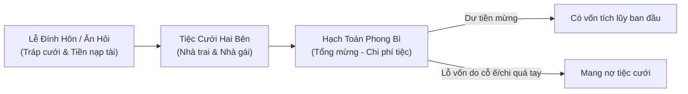
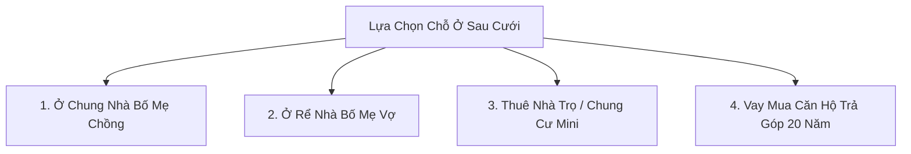
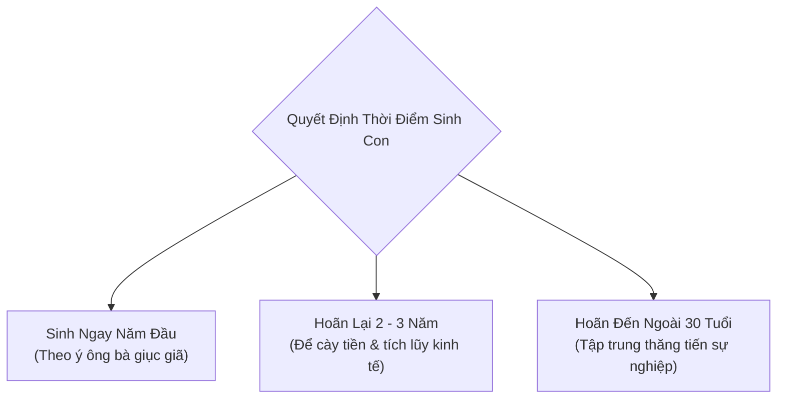

# Bản Kế Hoạch: Đám Cưới, An Cư & Kế Hoạch Sinh Con (Game Làm Cha Mẹ)

> **Mục tiêu**: Mô phỏng giai đoạn chuyển giao từ người độc thân sang trụ cột gia đình, bao gồm tổ chức lễ cưới theo phong tục Việt Nam, bài toán tìm nơi chốn an cư (ở chung hay thuê nhà/mua nhà), và quyết định chiến lược: Sinh con khi nào, mấy đứa và chuẩn bị kinh tế ra sao.

---

## 1. Tổ Chức Đám Cưới & Cân Đối Tài Chính (Wedding Economics)

Đám cưới ở Việt Nam vừa là ngày vui trăm năm, vừa là bài toán tài chính cân não:

### 1.1. Các khoản chi phí chính trong đám cưới
| Hạng mục | Quy mô tiết kiệm | Quy mô tiêu chuẩn | Quy mô hoành tráng |
| :--- | :---: | :---: | :---: |
| **Tiền nạp tài / Thách cưới** | 10 – 20 triệu | 30 – 50 triệu | 100+ triệu (kèm kiềng vàng) |
| **Tráp ăn hỏi (5 – 9 tráp)** | 5 – 8 triệu | 10 – 15 triệu | 25 – 40 triệu (tráp rồng phượng) |
| **Chụp ảnh cưới & Áo dài** | 4 – 7 triệu | 10 – 18 triệu | 25 – 50 triệu (chụp ngoại cảnh/resort) |
| **Tiệc cưới (30 – 60 bàn)** | 2.5 tr/bàn | 4.0 tr/bàn | 7.0+ tr/bàn (trung tâm tiệc cưới lớn) |
| **Kỳ trăng mật (Honeymoon)** | Đi gần (Đà Lạt/Vũng Tàu: 5tr) | Đà Nẵng/Phú Quốc (15 – 25tr) | Du lịch nước ngoài (Thái/Hàn: 40-70tr) |

### 1.2. Kịch bản tính toán tiền mừng cưới (Phong bì)
- Tiền mừng từ bạn bè, đồng nghiệp, họ hàng hai bên.
- **Nếu tổ chức hợp lý**: Thu về dư 30 – 80 triệu (khoản vốn đầu đời của đôi vợ chồng trẻ).
- **Nếu gia đình ít khách nhưng đặt cỗ sang chảnh**: Thâm hụt ngân sách từ 20 – 60 triệu (bắt đầu cuộc sống hôn nhân bằng một khoản nợ).

---

## 2. Bài Toán An Cư: Chọn Nơi Ở Sau Kết Hôn (Housing Dilemma)

Chỗ ở quyết định 60% mức độ hạnh phúc và xung đột hôn nhân ban đầu:

### 2.1. Phân tích chi tiết 4 phương án an cư

#### Phương án 1: Ở chung với Bố Mẹ Chồng (Sống chung tam đại đồng đường)
- **Ưu điểm**: 
  - Không tốn tiền thuê nhà hàng tháng.
  - Sau này có ông bà hỗ trợ bế cháu, nấu cơm, đỡ tiền thuê người giúp việc.
- **Thách thức**: 
  - Nguy cơ mâu thuẫn "Mẹ chồng - Nàng dâu" từ chuyện thói quen ăn uống, dọn dẹp, giờ giấc đi lại.
  - Thiếu không gian riêng tư của đôi trẻ; vợ dễ chịu ấm ức hoặc chồng kẹt ở giữa hai người phụ nữ.

#### Phương án 2: Ở Rể Nhà Bố Mẹ Vợ
- **Ưu điểm**: Vợ được ở gần bố mẹ đẻ nên thoải mái tâm lý; ông bà ngoại chăm con gái chu đáo.
- **Thách thức**: 
  - Chàng rể dễ cảm thấy tự ái hoặc áp lực từ họ hàng ("Chó chui gầm chạn").
  - Đòi hỏi người chồng phải khéo léo trong cư xử và bản lĩnh vững vàng.

#### Phương án 3: Thuê trọ / Thuê căn hộ độc lập bên ngoài
- **Chi phí**: 3.5 – 8 triệu đ/tháng (tùy phòng trọ khép kín hay căn hộ 1 phòng ngủ).
- **Ưu điểm**: Đôi vợ chồng hoàn toàn tự do, không bị ai soi xét giờ giấc, vợ chồng thoải mái yêu thương.
- **Thách thức**: 
  - Tiền thuê nhà chiếm 20 – 35% thu nhập hàng tháng, khó tích lũy tiền tiết kiệm.
  - Sau này sinh con sẽ phải tự xoay xở một mình rất vất vả nếu ông bà không lên phụ.

#### Phương án 4: Gom vốn & Vay ngân hàng mua chung cư trả góp
- **Chi phí**: Có sẵn 300 – 600 triệu (tiền tích lũy + bố mẹ cho), vay ngân hàng 1 – 1.5 tỷ trong 15 – 20 năm.
- **Ưu điểm**: Có sổ hồng chính chủ, an cư lạc nghiệp, con cái có hộ khẩu thành phố để học trường tốt.
- **Thách thức**: 
  - Áp lực trả gốc và lãi ngân hàng 10 – 18 triệu đ/tháng đều đặn như vắt chanh.
  - Nếu một trong hai người mất việc hoặc giảm lương, gia đình lập tức rơi vào khủng hoảng tài chính.

---

## 3. Kế Hoạch Sinh Con: Khi Nào Sinh & Nuôi Mấy Đứa? (Family Planning)

Quyết định sinh con là bước ngoặt tối thượng biến người chơi thành "Làm Cha Mẹ".

### 3.1. Các yếu tố tác động đến thời điểm sinh con
1. **Áp lực gia đình hai bên**: Bố mẹ già yếu ngày nào cũng nhắc: *"Mau sinh cháu cho tao bế, không mấy nữa tao già không trông được đâu!"*
2. **Kinh tế tích lũy dự phòng**: 
   - Mức an toàn khuyến nghị trước khi mang thai: Có tối thiểu **50 – 100 triệu VNĐ** tiền mặt phòng khi sinh nở và các tháng vợ nghỉ thai sản.
3. **Tuổi tác & Sức khỏe sinh sản**:
   - Độ tuổi sinh con lý tưởng: 24 – 32 tuổi. Sau 35 tuổi nguy cơ thai kỳ tăng cao, tốn kém chi phí khám sàng lọc.

### 3.2. Áp lực "Quý tử / Con trai nối dõi" trong văn hóa truyền thống
- Nếu sinh con gái đầu lòng:
  - Một số gia đình tư tưởng truyền thống (đặc biệt là con trai trưởng hoặc dòng họ miền Bắc/Trung) sẽ gây sức ép: *"Phải kiếm đứa con trai nối dõi tông đường, thờ cúng tổ tiên!"*
  - Người chơi sẽ đối mặt với quyết định: Tiếp tục sinh con thứ hai/thứ ba để tìm con trai, hay dừng lại bảo vệ sức khỏe người vợ.

### 3.3. Kế hoạch số lượng con
- **Nuôi 1 con**: Đầu tư tối đa mọi nguồn lực (cho học trường quốc tế, học đàn, học bơi), nhưng con dễ cô đơn và chịu toàn bộ kỳ vọng của bố mẹ.
- **Nuôi 2 con ("Đủ nếp đủ tẻ")**: Mô hình lý tưởng của hầu hết gia đình Việt Nam; các con có anh có em chia sẻ; chi phí nhân đôi nhưng gia đình vui vẻ trọn vẹn.
- **Nuôi 3 con trở lên**: Không khí gia đình rộn ràng ấm cúng, nhưng gánh nặng tài chính cực kỳ khốc liệt, người cha hoặc người mẹ phải hy sinh toàn bộ sự nghiệp riêng.

---

## 4. Chi Phí Chuẩn Bị Cho Ngày Đứa Con Chào Đời

Trước khi bước vào phòng sinh, người chơi phải chuẩn bị ngân sách:

| Khoản mục | Gói Bình Dân (Viện Công) | Gói Tiêu Chuẩn (Viện Phụ Sản) | Gói Quốc Tế (Vinmec, FV...) |
| :--- | :---: | :---: | :---: |
| **Khám thai & Sàng lọc dị tật** | 3 – 5 triệu | 8 – 15 triệu | 20 – 35 triệu |
| **Gói đỡ đẻ / Mổ sinh** | 5 – 8 triệu | 12 – 22 triệu | 40 – 75 triệu |
| **Đồ dùng sơ sinh (Tã, bình sữa, nôi)** | 4 – 7 triệu | 10 – 18 triệu | 25 – 45 triệu |
| **Quỹ dự phòng thai sản 6 tháng** | 20 – 30 triệu | 40 – 60 triệu | 80 – 150 triệu |

Khi người chơi bấm **"Đón con chào đời"**, game sẽ chuyển tiếp vào **Giai Đoạn 4: 18 Năm Hành Trình Nuôi Dạy Con Trưởng Thành**.
