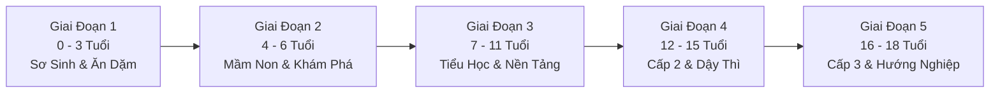

# Bản Kế Hoạch: 18 Năm Hành Trình Nuôi Con Trưởng Thành (Game Làm Cha Mẹ)

> **Mục tiêu**: Thiết kế lõi gameplay chính (*Core Gameplay Loop*) mô phỏng toàn bộ 18 năm nuôi con của cha mẹ Việt Nam. Mỗi năm là những quyết định cân não giữa tài chính, thời gian đồng hành, phương pháp giáo dục và các biến cố bất ngờ xảy ra trong cuộc sống.

---

## 1. Bản Đồ 5 Giai Đoạn Nuôi Con (The 5 Life Stages)

---

## 2. Hệ Thống Chỉ Số Của Đứa Con & Cha Mẹ (Stats Matrix)

### 2.1. Bộ chỉ số của Con (Child Attributes: Thang điểm 0 – 100)
- **Thể Lực & Sức Khỏe (Health)**: Sức đề kháng, ít ốm vặt, chiều cao cân nặng chuẩn.
- **Trí Tuệ & Học Lực (IQ / Academics)**: Khả năng tiếp thu, tư duy logic, điểm số trên lớp.
- **Trí Tuệ Cảm Xúc & Kỹ Năng Xã Hội (EQ)**: Khả năng thấu cảm, giao tiếp, kết bạn, biết sẻ chia.
- **Đạo Đức & Lòng Hiếu Thảo (Morality)**: Kính trọng ông bà cha mẹ, biết ơn, có trách nhiệm với gia đình.
- **Tính Tự Lập & Bản Lĩnh (Independence)**: Tự làm việc cá nhân, tự đứng dậy sau thất bại, không ỷ lại.

### 2.2. Tài nguyên quản trị của Cha Mẹ (Parent Resources)
- **Quỹ Tiền Mặt Gia Đình (VND)**: Tích lũy hàng tháng sau khi trừ tiền ăn, tiền trọ/trả góp và chi phí nuôi con.
- **Năng Lượng & Sức Bền (Stamina: 0 – 100)**: Bị bào mòn bởi áp lực công việc và thức đêm chăm con.
- **Hạnh Phúc Hôn Nhân (Marriage Bond: 0 – 100)**: Tình cảm vợ chồng mặn nồng hay căng thẳng vì chuyện chăm sóc con cái và tiền bạc.

---

## 3. Chi Tiết 5 Giai Đoạn Phát Triển

---

### Giai Đoạn 1: Tuổi Sơ Sinh & Tập Đi (0 – 3 Tuổi)
- **Bối cảnh**: Giai đoạn tốn kém và mệt mỏi nhất về mặt thể chất của đôi vợ chồng trẻ.
- **Các quyết định trọng tâm**:
  1. *Nuôi con bằng sữa mẹ hay sữa công thức nhập khẩu?* (Sữa mẹ tiết kiệm nhưng mẹ mệt mỏi; sữa Nhật/Mỹ tốn 3 – 5 triệu/tháng).
  2. *Tiêm chủng mở rộng ở trạm xá phường hay tiêm trọn gói dịch vụ VNVC?* (Gói tiêm dịch vụ 15 – 25 triệu phòng ngừa đầy đủ, không phải xếp hàng).
  3. *Mâu thuẫn nuôi con giữa 2 thế hệ*: Mẹ chồng muốn cho cháu ăn dặm bột sớm, nêm mắm muối, rơ lưỡi bằng mật ong vs Người mẹ trẻ muốn nuôi con theo khoa học (ăn dặm tự chỉ huy BLW, không gia vị).
- **Biến cố ngẫu nhiên**: 
  - Đêm khuya con sốt cao 39.5 độ co giật, vợ chồng hớt hải bế đi cấp cứu viện Nhi trong mưa gió.
  - Người mẹ bị trầm cảm sau sinh do mất ngủ kéo dài và chồng vô tâm không chia sẻ việc bỉm sữa.

---

### Giai Đoạn 2: Mầm Non & Khám Phá Thế Giới (4 – 6 Tuổi)
- **Bối cảnh**: Con bắt đầu biết nói, tò mò hỏi đủ thứ chuyện và bước chân vào trường mầm non.
- **Các quyết định trọng tâm**:
  1. *Lựa chọn trường mầm non*:
     - *Trường công lập gần nhà*: 1.5 – 2.5 triệu/tháng (Lớp đông 35-40 cháu, cô giáo vất vả, đón sớm trước 17h).
     - *Trường tư thục chất lượng cao*: 4 – 8 triệu/tháng (Có camera trực tuyến, học tiếng Anh với giáo viên bản ngữ, gửi muộn).
     - *Trường quốc tế / Montessori*: 12 – 25 triệu/tháng (Cơ sở vật chất hiện đại, bữa ăn dinh dưỡng hữu cơ).
  2. *Ứng xử khi con ăn vạ nơi công cộng*:
     - Con khóc lóc đòi mua đồ chơi đắt tiền giữa trung tâm thương mại.
     - Lựa chọn: Mua ngay cho con nín (tăng ỷ lại), Đánh mắng giữa nơi đông người (giảm EQ/tự trọng của con), hay Bình tĩnh ngồi xuống kiên nhẫn giải thích và đợi con nín khóc (tăng Tự lập & EQ).
- **Biến cố ngẫu nhiên**: Con ốm sốt virus lây chéo ở lớp, tuần đi học 3 ngày tuần nghỉ 4 ngày khiến cha mẹ phải thay phiên nhau xin nghỉ phép cơ quan.

---

### Giai Đoạn 3: Tiểu Học & Xây Dựng Nền Tảng (7 – 11 Tuổi)
- **Bối cảnh**: Bước vào lớp 1 - Cuộc chiến rèn chữ, làm bài tập về nhà và các kỳ thi giữa kỳ.
- **Các quyết định trọng tâm**:
  1. *Có nên chạy đua "chạy trường / xin vào lớp chọn"?* (Tốn một khoản phí ngoại giao 15 – 40 triệu để con được học cô giáo chủ nhiệm giỏi nhất khối).
  2. *Luyện viết chữ đẹp & Làm bài tập về nhà*:
     - Buổi tối dạy con học: Giữ bình tĩnh kiên nhẫn giảng bài hay bốc hỏa quát mắng vì *"1 + 1 dạy mãi không hiểu"*?
  3. *Áp lực "Con Nhà Người Ta" & Nhóm Zalo Phụ Huynh*:
     - Nhìn bảng xếp hạng và các phụ huynh khác khoe giấy khen, giải thưởng thi Toán Kangaroo, Tiếng Anh IOE.
     - Lựa chọn: Cho con đi học thêm kín cả tuần từ thứ 2 đến chủ nhật, hay để con có thời gian vui chơi đá bóng bơi lội với bạn bè?
- **Biến cố ngẫu nhiên**: Con bị bạn cùng lớp tẩy chay hoặc giấu cặp sách; con trộm tiền trong ví của bố mẹ để mua thẻ bài Pokemon/trà sữa cùng bạn.

---

### Giai Đoạn 4: Cấp 2 & Dậy Thì Nổi Loạn (12 – 15 Tuổi)
- **Bối cảnh**: Cơ thể con thay đổi nhanh chóng, tâm sinh lý nhạy cảm, cái tôi hình thành mạnh mẽ.
- **Các quyết định trọng tâm**:
  1. *Mua điện thoại thông minh (Smartphone) cho con*:
     - Mua iPhone cho con để liên lạc hay chỉ cho dùng máy bàn phím "cục gạch"?
     - Kiểm soát giờ giấc dùng mạng xã hội (TikTok, Facebook, chơi game Free Fire/Liên Quân).
  2. *Giáo dục giới tính & Tình yêu bọ xít*:
     - Bắt gặp con nhắn tin hẹn hò với bạn khác giới, nắm tay nhau sau giờ học.
     - Lựa chọn: Cấm đoán gay gắt, tịch thu điện thoại (gây phản kháng dữ dội) hay nhẹ nhàng bầu bạn, chia sẻ kiến thức bảo vệ bản thân?
  3. *Cuộc thi chuyển cấp vào Lớp 10 Công Lập*:
     - Kỳ thi vào lớp 10 ở các thành phố lớn (Hà Nội, TP.HCM) căng thẳng hơn cả thi đại học.
     - Tỷ lệ chọi khốc liệt: Nếu trượt công lập phải học dân lập học phí gấp 4 lần hoặc học giáo dục thường xuyên.
- **Biến cố ngẫu nhiên**: Con đi chơi cùng nhóm bạn hư hỏng tụ tập hút thuốc lá điện tử hoặc trốn học đi net; con đóng chặt cửa phòng cả ngày không chịu nói chuyện với cha mẹ.

---

### Giai Đoạn 5: Cấp 3 & Bước Ngoặt Cuộc Đời (16 – 18 Tuổi)
- **Bối cảnh**: Những năm tháng thanh xuân cuối cùng dưới mái trường, trước khi con trở thành công dân trưởng thành độc lập.
- **Các quyết định trọng tâm**:
  1. *Định hướng nghề nghiệp & Thi THPT Quốc gia*:
     - Mâu thuẫn truyền thống gia đình: Bố mẹ muốn con thi Sư phạm, Bác sĩ hoặc Công an để ổn định và mát mặt dòng họ vs Con tha thiết muốn theo ngành Thiết kế mỹ thuật, Truyền thông đa phương tiện hoặc Âm nhạc.
  2. *Kinh phí đại học & Tự lập*:
     - Cha mẹ cam kết chu cấp toàn bộ 4 năm đại học hay yêu cầu con đi làm thêm bán thời gian (bưng bê, gia sư) để tự trang trải sinh hoạt phí?
  3. *Khoảnh khắc chia tay*:
     - Con nhận giấy báo trúng tuyển đại học ở thành phố xa hoặc đi du học.
     - Ngày tiễn con lên xe khách cùng bao tải gạo quê và hành lý đầu đời.
- **Biến cố ngẫu nhiên**: Con đạt giải Học sinh giỏi Quốc gia được tuyển thẳng; hoặc con áp lực ôn thi quá mức dẫn đến suy nhược cơ thể phải nhập viện trước ngày thi 1 tuần.

---

## 4. Bảng Tổng Hợp Chi Phí Nuôi Con 18 Năm Tại Việt Nam

| Phân tầng xã hội | Chi phí ước tính 18 năm | Mức chi tiêu trung bình / tháng | Chất lượng môi trường giáo dục |
| :--- | :---: | :---: | :--- |
| **Gia đình nghèo / Bình dân** | 450 – 800 triệu VNĐ | 2.0 – 3.7 triệu/tháng | Trường công lập, tự học là chính, con sớm phụ việc gia đình |
| **Gia đình Trung lưu khá giả** | 1.2 – 2.5 tỷ VNĐ | 5.5 – 11.5 triệu/tháng | Trường tư thục, học thêm tiếng Anh IELTS, các khóa năng khiếu kỹ năng |
| **Gia đình Thượng lưu giàu có** | 4.0 – 8.0+ tỷ VNĐ | 18 – 37 triệu/tháng | Mầm non quốc tế, trường song ngữ, trại hè nước ngoài, du học dự bị |
