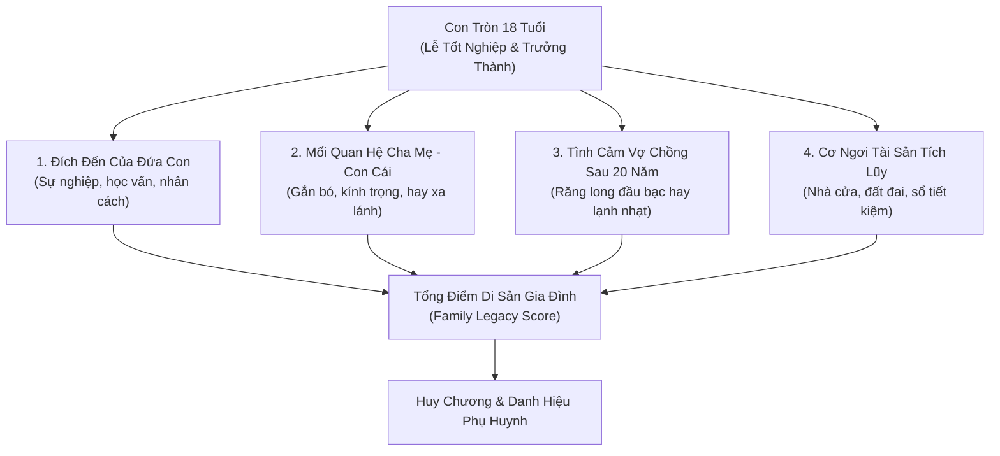

# Bản Kế Hoạch: Kết Thúc, Đánh Giá Di Sản & Hậu Vận (Game Làm Cha Mẹ)

> **Mục tiêu**: Xây dựng hệ thống hồi kết sâu sắc (*Endgame & Legacy System*). Khi đứa con tròn 18 tuổi bước vào đời, game sẽ tổng kết toàn bộ hành trình làm cha mẹ: Thành tựu của con cái, mối quan hệ gia đình, tình cảm vợ chồng sau hơn 20 năm gắn bó, và trao các danh hiệu phụ huynh phản ánh phong cách dạy con của người chơi.

---

## 1. Cấu Trúc Tổng Kết Cuộc Đời (Endgame Summary Screen)

---

## 2. Các Kết Cục Trưởng Thành Của Con Cái (Child Life Outcomes)

Dựa trên 5 chỉ số cốt lõi (Thể lực, Trí tuệ, EQ, Đạo đức, Tự lập) tích lũy trong 18 năm:

| Kết cục trưởng thành | Điều kiện chỉ số | Mô tả tương lai đứa con | Cảm xúc của cha mẹ |
| :--- | :--- | :--- | :--- |
| **Học Bá / Du Học Sinh Tinh Hoa** | IQ ≥ 85, Đạo đức ≥ 70 | Đỗ thủ khoa Đại học Ngoại Thương / Bách Khoa hoặc nhận học bổng toàn phần du học Mỹ, Úc. | Tự hào tột bậc, rạng danh dòng họ tổ tiên. |
| **Công Dân Vững Vàng Tự Lập** | Tự lập ≥ 80, EQ ≥ 75, IQ ≥ 65 | Tự tin khởi nghiệp mở công ty riêng hoặc làm chuyên viên tài năng, sớm tự mua được xe và lo cho bản thân. | An tâm, tự hào vì con đã có thể tự đứng vững trên đôi chân. |
| **Người Con Hiếu Thảo Ấm Áp** | Đạo đức ≥ 90, EQ ≥ 80 | Trở thành giáo viên, bác sĩ hoặc cán bộ tận tụy; tuần nào cũng về thăm và nấu cơm cho bố mẹ. | Hạnh phúc ngập tràn, tuổi già ấm áp không cô đơn. |
| **Thợ Lành Nghề Chân Chất** | Tự lập ≥ 70, Thể lực ≥ 80 | Tốt nghiệp trường nghề kỹ thuật, làm thợ sửa chữa hoặc kỹ thuật viên xưởng có tay nghề cao, sống lương thiện. | Nhẹ lòng, hài lòng với hạnh phúc bình dị đời thường. |
| **Kẻ Lạnh Lùng Vô Cảm (Trái đắng kỳ vọng)** | IQ ≥ 85 nhưng EQ < 40, Đạo đức < 45 | Thành đạt kiếm nhiều tiền nhưng coi bố mẹ là gánh nặng; chỉ gửi tiền về mà không một lần gọi điện hỏi thăm. | Xót xa cay đắng: Sinh con ra thành tài nhưng mất đi một người con. |
| **Thanh Niên Bất Hảo / Sa Ngã** | Đạo đức < 40, Tự lập < 35, Thể lực yếu | Sa vào nợ nần cá độ, tụ tập bạn xấu quậy phá, thường xuyên về vòi tiền bố mẹ già trả nợ. | Bất lực, ân hận vì những năm tháng đã quá nuông chiều hoặc bỏ bê con. |

---

## 3. Mối Quan Hệ Cha Mẹ - Con Cái Sau 18 Năm (Parent-Child Bond)

- **Mối quan hệ "Bạn Tâm Giao" (Gắn kết ≥ 85)**: Con coi cha mẹ như người bạn lớn, mọi khó khăn trong cuộc sống hay chuyện tình cảm đều tâm sự chia sẻ đầu tiên.
- **Mối quan hệ "Kính Nhi Viễn Chi" (Gắn kết 50 – 84, Áp đặt cao)**: Con ngoan ngoãn nghe lời, có trách nhiệm chu cấp đầy đủ nhưng luôn giữ khoảng cách phòng thủ, không bao giờ chia sẻ cảm xúc thật.
- **Mối quan hệ "Xa Cách Lạnh Nhạt" (Gắn kết 25 – 49)**: Sau khi tốt nghiệp THPT, con lập tức rời khỏi nhà, chọn trường đại học thật xa và rất hiếm khi về thăm nhà.
- **Mối quan hệ "Oán Hận / Đoạn Tuyệt" (Gắn kết < 25)**: Con mang vết thương tâm lý nặng nề từ những trận đòn roi, mắng mỏ xúc phạm hoặc bị ép buộc theo ý cha mẹ; cắt đứt liên lạc.

---

## 4. Hậu Vận Vợ Chồng Sau 20 Năm Chung Sống (Marital Retrospective)

1. **Răng Long Đầu Bạc (Hôn nhân ≥ 85)**: Vượt qua bao sóng gió cơm áo gạo tiền, hai vợ chồng chiều chiều cùng nhau đi bộ tập dưỡng sinh, cùng pha ấm trà ôn lại kỷ niệm thời trẻ nghèo khó.
2. **Nghĩa Cũ Còn Vương (Hôn nhân 50 – 84)**: Tình yêu thuở ban đầu đã phai nhạt, nhường chỗ cho tình thương và trách nhiệm. Hai người sống chung nhà vì các con, đối đãi với nhau hòa nhã.
3. **Chiến Tranh Lạnh (Hôn nhân 30 – 49)**: Thường xuyên ngủ riêng phòng, không còn tiếng cười trong căn nhà; chỉ nói chuyện khi liên quan đến tiền bạc hoặc con cái.
4. **Ly Hôn Đôi Ngả (Hôn nhân < 30 tại bất kỳ năm nào)**: Vợ chồng ký đơn ly dị, con cái phải chia tay một trong hai người, mỗi người xây dựng lại cuộc sống riêng.

---

## 5. Bảng Huy Hiệu & Danh Hiệu Phụ Huynh (Parenting Badges)

Game vinh danh người chơi bằng các huy hiệu độc đáo dựa trên thành quả đạt được:

| Tên Danh Hiệu | Ý nghĩa & Điều kiện đạt được | Biểu tượng |
| :--- | :--- | :---: |
| **Người Cha / Người Mẹ Vĩ Đại** | Cân bằng hoàn hảo: Con cái thành tài, gắn kết cao, hôn nhân viên mãn, tài chính vững vàng. | 👑 |
| **Mái Ấm Nghĩa Tình** | Xuất phát từ gia cảnh nghèo nàn nợ nần, nhưng nuôi dạy con nên người ngoan ngoãn, gia đình hòa thuận. | 🏠 |
| **Hổ Phụ Sinh Hổ Tử** | Con cái đạt học lực xuất chúng, thi đỗ thủ khoa hoặc trở thành nhân vật kiệt xuất trong xã hội. | 🦅 |
| **Bến Đỗ Bình Yên** | Không đặt nặng thành tích, ưu tiên sức khỏe tinh thần và nụ cười của con; con cái lớn lên giàu lòng trắc ẩn. | 🕊️ |
| **Hi Sinh Thầm Lặng** | Người cha/mẹ nhịn ăn nhịn mặc, làm lụng kiệt sức để dồn toàn bộ tương lai tươi sáng cho đứa con. | 🕯️ |
| **Trái Đắng Kỳ Vọng** | Dồn ép con học ngày học đêm để thỏa mãn sĩ diện bản thân, đổi lại con thành đạt nhưng cạch mặt gia đình. | 🥀 |
| **Vấp Ngã Đứng Lên** | Từng đứng trên bờ vực phá sản hoặc ly hôn nhưng đã kịp hàn gắn và cứu vãn hạnh phúc gia đình. | 🛡️ |

---

## 6. Tính Năng Thế Hệ Kế Thừa (New Game+: Đời Con Bước Vào Tuổi 18)

Sau khi màn hình tổng kết hiện ra, người chơi có thể:
- **Xem Cuốn Album Kỷ Niệm 18 Năm**: Lướt lại những bức ảnh và cột mốc đáng nhớ nhất từ ngày đón con ở viện phụ sản đến ngày con tốt nghiệp cấp 3.
- **Kích hoạt Chế độ "Thế Hệ Nối Tiếp"**: Tiếp tục chơi tiếp lượt mới với tư cách là **Chính Đứa Con Vừa Tròn 18 Tuổi**, mang theo tài sản thừa kế, gia cảnh và nếp sống của gia đình mình vừa gầy dựng!
